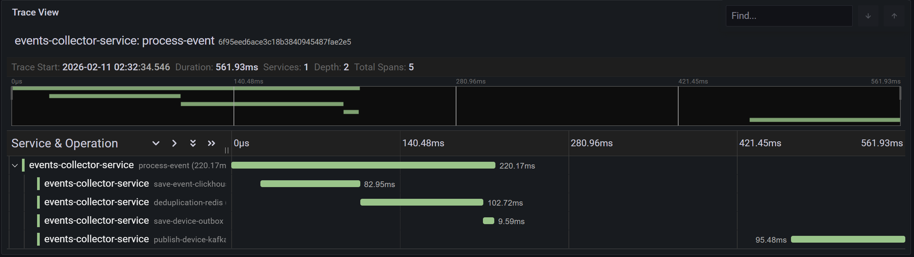

## events-collector-service

### Технологический стек

- **Язык**: Java 24
- **Фреймворк**: Spring Boot 3.5 (Web, Scheduling, Data Redis, JDBC, Actuator)
- **Kafka**: Spring for Apache Kafka, Confluent Avro Serializer, Schema Registry
- **Хранение**: ClickHouse, Liquibase (в т.ч. `liquibase-clickhouse`)
- **Кэш/идемпотентность**: Redis
- **Наблюдаемость**: Micrometer (Prometheus, OTLP), Spring Boot Actuator
- **Маппинг**: MapStruct, Lombok

### Описание

`events-collector-service` — это сервис обработки событий IoT‑устройств, который потребляет сырые события из Kafka, 
сохраняет их в ClickHouse и формирует outbox для последующей отправки обработанных данных об устройствах в отдельный 
Kafka‑топик.

Сервис реализует паттерны **deduplication** и **outbox**, использует **Redis** для идемпотентности и распределения 
нагрузки между инстансами, а также **Liquibase** для миграций схемы ClickHouse. Наблюдаемость реализована через 
Spring Boot Actuator и Micrometer (Prometheus, OTLP).

**Первичный поток данных:**

1. Сырые события `DeviceEvent` приходят в Kafka‑топик `events.v1` (Avro, Schema Registry).
2. Листенер читает события, маппит в модель `DeviceEvent` и сохраняет в таблицу `collector.device_events` в ClickHouse.
3. Для новых `deviceId` за период TTL событие попадает в таблицу `collector.device_outbox`.
4. Фоновый процесс `OutboxProcessor` по расписанию читает записи из `device_outbox`, идемпотентно публикует сведения 
об устройствах в Kafka‑топик `devices.v1` и помечает записи как отправленные.

### Основные компоненты

- **Потребитель сырых событий**: `EventListener`
  - Читает `GenericRecord` из Kafka (`events.v1`), маппит в `DeviceEvent` и передаёт в `EventService`.
  - Замеряет пропускную способность через `ThroughputMeter`.
- **Обработка событий**: `EventService`
  - Сохраняет событие в ClickHouse через `EventRepository`.
  - Использует `DeduplicationService` для определения новых `deviceId`.
  - Записывает новые устройства в outbox (`DeviceOutbox`, `OutboxRepository`).
- **Дедупликация**: `DeduplicationService`
  - Работает поверх Redis‑множества `devices:seen` (ключ и TTL настраиваются).
  - Гарантирует, что для каждого устройства за заданный TTL outbox‑запись создаётся только один раз.
- **Outbox‑процессор**: `OutboxProcessor`
  - По cron‑расписанию выбирает из `device_outbox` записи для своего шарда (через `InstanceRegistry`).
  - Идемпотентно публикует сообщения об устройствах в Kafka (`DevicePublisher`) с помощью Redis‑ключа `devices:published`.
- **Публикатор устройств**: `DevicePublisher`
  - Публикует Avro‑записи в Kafka‑топик `devices.v1` с ключом `deviceId`.
- **Хранение**: ClickHouse + Liquibase
  - Миграции описаны в `db/changelog` (XML + SQL‑скрипты).
  - Используется JDBC‑драйвер ClickHouse и `liquibase-clickhouse`.
- **Конфигурация Kafka и Schema Registry**: `KafkaListenerConfig`, `KafkaPublisherConfig`, `SchemaRegistryConfig`.
- **Конфигурация ClickHouse**: `ClickHouseConfig`, `ClickHouseProperties`.
- **Redis‑клиент**: `RedisClient` — обёртка над Redis для операций SADD с TTL и др.
- **Кастомные метрики**: `CollectorMetrics` (Micrometer)
  - `events.processed.total` — общее число успешно обработанных сырых событий из Kafka (`EventListener` → после успешного `EventService.process`).
  - `events.duplicates.total` — число событий, для которых `deviceId` уже встречался в пределах TTL дедупликации, и outbox‑запись не создавалась (`EventService`).
  - `outbox.pending.count` — gauge с текущим количеством записей в `collector.device_outbox`, ожидающих обработки (`OutboxRepository.countPending`).
  - `outbox.publish.success.total` — общее число успешно опубликованных записей из outbox в Kafka (`OutboxProcessor`, успешный `publish`).
  - `outbox.publish.fail.total` — общее число неудачных попыток отправки записей из outbox в Kafka (`OutboxProcessor`, исключение при `publish`).

---

## Мониторинг и трассировка

Сервис экспортирует метрики в Prometheus и трейсы в Tempo. В составе инфраструктуры (Grafana, Alloy, Prometheus, Tempo) доступны дашборды и просмотр трассировок.

### Метрики (Prometheus)

- **Эндпоинт**: Spring Boot Actuator — `http://<host>:9090/actuator/prometheus` (в Docker порт 9090 пробрасывается на хост; при локальном запуске см. `management.server.port` в профиле).
- **Сбор**: в Docker-окружении [Alloy](https://grafana.com/docs/alloy/latest/) обнаруживает контейнеры `events-collector-service`, скрапит каждый инстанс по адресу `:9090/actuator/prometheus` (интервал 10 с) и отдаёт метрики в Prometheus (remote write). Конфигурация — `infrastructure/alloy/config.alloy` (discovery и job `events-collector-service`).
- **Кастомные метрики** сервиса перечислены выше в блоке «Кастомные метрики» (`CollectorMetrics`). Имена в Prometheus: `events_processed_total`, `events_duplicates_total`, `outbox_pending_count`, `outbox_publish_success_total`, `outbox_publish_fail_total` (с точками в коде они экспортируются с подчёркиваниями).

### Трассировка (Tempo)

Сервис строит один сквозной трейс на обработку события: от приёма до публикации в Kafka. Используются **Micrometer Tracing** и мост в OpenTelemetry (OTLP).

- **Экспорт**: трейсы отправляются по OTLP HTTP. Endpoint задаётся в `management.otlp.tracing.endpoint`:
  - **local**: `http://localhost:4318/v1/traces` (нужен локальный Alloy или иной OTLP-приёмник).
  - **docker**: `http://alloy:4318/v1/traces` (при необходимости переопределяется через `OTEL_EXPORTER_OTLP_TRACES_ENDPOINT`).
- **Цепочка**: приложение → OTLP HTTP → Alloy (4318) → Tempo (gRPC 4317). В Alloy: `otelcol.receiver.otlp` (HTTP 4318), экспорт — `otelcol.exporter.otlp.tempo`.
- **Иерархия спанов** (один трейс = одно событие):
  ```
  process-event (корень)
  ├── save-event-clickhouse
  ├── deduplication-redis
  ├── save-device-outbox
  └── publish-device-kafka   (создаётся при публикации из outbox, позже по расписанию)
  ```
  Корневой спан **process-event** создаётся в `EventService.process()`. Его `traceId` и `spanId` сохраняются в `device_outbox` (поля `trace_id`, `span_id`). При публикации записи из outbox (`OutboxProcessor`) спан **publish-device-kafka** создаётся с родителем по этому контексту (`TraceContextCapture.runInContinuedTrace`), поэтому в Tempo все спаны оказываются в одном трейсе.
- **Просмотр**: Grafana → **Explore** → источник **Tempo**. Поиск по `service.name=events-collector-service` или по `traceId`.



Семплирование задаётся в профиле (`management.tracing.sampling.probability`, в `application-docker.yaml` — `1.0`). Трейсинг для scheduled-задач (outbox, heartbeat) отключён в `TracingConfig`, чтобы в Tempo не попадали лишние трейсы.

### Grafana

- **Дашборд «Events Collector Service»** (`infrastructure/grafana/dashboards/events-collector.json`) провижинится при старте Grafana и содержит:
  - скорость обработки событий и дубликатов (rate по `events_processed_total`, `events_duplicates_total`);
  - число записей в outbox (`outbox_pending_count`);
  - соотношение успешных/неуспешных публикаций из outbox (success/fail total и ratio);
  - графики «processed vs duplicates», «duplicates ratio».
- **Датасорсы** Prometheus и Tempo настраиваются в `infrastructure/grafana/provisioning/datasources/datasources.yaml` (при запуске через корневой `Makefile` или `docker compose` они уже подключены).

При необходимости переопределения OTLP endpoint для трейсов укажите переменную окружения `OTEL_EXPORTER_OTLP_TRACES_ENDPOINT` (полный URL, например `http://alloy:4318/v1/traces`).

---

## Конфигурация

Основные настройки задаются в `application.yaml` и профилях `application-local.yaml` / `application-docker.yaml`.

### Kafka

- Сырые события:
  - Топик входа: `collector.listener.kafka-topic` (по умолчанию `events.v1`).
  - Группа потребителя: `spring.kafka.consumer.group-id=events-collector-service-group`.
  - Значения — Avro (`KafkaAvroDeserializer`), `schema.registry.url` задаётся переменной окружения `SCHEMA_REGISTRY_URL`.
- Outbox‑отправка:
  - Топик устройств: `collector.outbox.kafka-topic` (по умолчанию `devices.v1`).
  - Используется `KafkaAvroSerializer` и Confluent Schema Registry.

**Переменные окружения (основные):**

- `KAFKA_BOOTSTRAP_SERVERS` — адреса брокеров Kafka.
- `SCHEMA_REGISTRY_URL` — URL Schema Registry.

### ClickHouse

Конфигурируется через префикс `clickhouse.*`:

- `clickhouse.datasource.url` — JDBC‑URL ClickHouse (в `local` профиле по умолчанию `jdbc:clickhouse://localhost:8123/clickhouse?compress=0`).
- `clickhouse.datasource.username`, `clickhouse.datasource.password`.
- Параметры пула подключений: `maximum-pool-size`, `minimum-idle`, таймауты и пр.

**Переменные окружения (основные):**

- `CLICKHOUSE_URL`
- `CLICKHOUSE_USER`
- `CLICKHOUSE_PASSWORD`

Схема и таблицы создаются и мигрируются через Liquibase (`db/changelog/db.changelog-master.xml` и включаемые файлы).

### Redis

Используется для:

- дедупликации устройств (`collector.deduplication.seen-key`, TTL — `collector.deduplication.seen-ttl-seconds`);
- идемпотентности outbox‑отправки (`collector.outbox.published-key`, TTL — `collector.outbox.published-ttl-seconds`);
- регистрации инстансов для шардинга (`InstanceRegistry`).

**Переменные окружения (основные):**

- `REDIS_HOST`
- `REDIS_PORT`
- `REDIS_PASSWORD`

Профили `local` и `docker` задают значения по умолчанию для этих параметров.

### Профили Spring

- **`local`**:
  - используется при запуске через `./gradlew bootRun` (см. `tasks.bootRun` в `build.gradle.kts`);
  - задаёт локальные дефолты для Kafka, Redis и ClickHouse (localhost, тестовые логин/пароль).
- **`docker`**:
  - используется в контейнере (см. `Dockerfile`: `SPRING_PROFILES_ACTIVE=docker`);
  - предполагает использование инфраструктуры из `docker-compose` (Kafka, Redis, ClickHouse, Schema Registry).

---

## Локальный запуск

### Требования

- Java 24
- Gradle
- Docker
- Доступный:
  - кластер Kafka и Schema Registry;
  - инстанс Redis;
  - база ClickHouse с возможностью применения миграций Liquibase.

### Сборка

Из корня `events-collector-service`:

```bash

./gradlew clean build
```

На Windows (PowerShell):

```powershell
.\gradlew clean build
```

### Запуск через Gradle (профиль `local`)

```bash

./gradlew bootRun
```

- Профиль: `local` (устанавливается в `build.gradle.kts`).
- Миграции Liquibase применяются автоматически при старте.
- По умолчанию используются локальные значения:
  - `KAFKA_BOOTSTRAP_SERVERS=localhost:19092,localhost:19093,localhost:19094`
  - `SCHEMA_REGISTRY_URL=http://localhost:8081`
  - `REDIS_HOST=localhost`, `REDIS_PORT=6379`, `REDIS_PASSWORD=admin`
  - `CLICKHOUSE_URL=jdbc:clickhouse://localhost:8123/clickhouse?compress=0`
  - `CLICKHOUSE_USER=admin`, `CLICKHOUSE_PASSWORD=admin`

При необходимости переопределите переменные окружения перед запуском:

```bash

export KAFKA_BOOTSTRAP_SERVERS="localhost:9092"
export SCHEMA_REGISTRY_URL="http://localhost:8081"
export REDIS_HOST="localhost"
export REDIS_PORT="6379"
export REDIS_PASSWORD="admin"
export CLICKHOUSE_URL="jdbc:clickhouse://localhost:8123/clickhouse?compress=0"
export CLICKHOUSE_USER="admin"
export CLICKHOUSE_PASSWORD="admin"
./gradlew bootRun
```

---

## Запуск в Docker

Описан в [README.md](../README.md) верхнего уровня (в корневой директории всей системы).

---

## Тестирование

### Юнит‑тесты и интеграционные тесты

Запуск всех тестов:

```bash

./gradlew test
```

Сервис содержит:

- **юнит‑тесты** для основных доменных сервисов (`DeduplicationServiceTest`, `EventServiceTest`, `OutboxProcessorTest`);
- **интеграционные тесты** на основе Testcontainers:
  - Kafka, Redis, ClickHouse, Schema Registry поднимаются как тестовые контейнеры;
  - `FullIntegrationTest` проверяет полный путь: `events.v1 → ClickHouse (device_events + device_outbox) → processOutbox → devices.v1`.

### Отчёт о покрытии (JaCoCo)

Для генерации отчёта:

```bash

./gradlew jacocoTestReport
```

Отчёт будет доступен в виде HTML и XML (см. конфигурацию задачи `jacocoTestReport` в `build.gradle.kts`).

